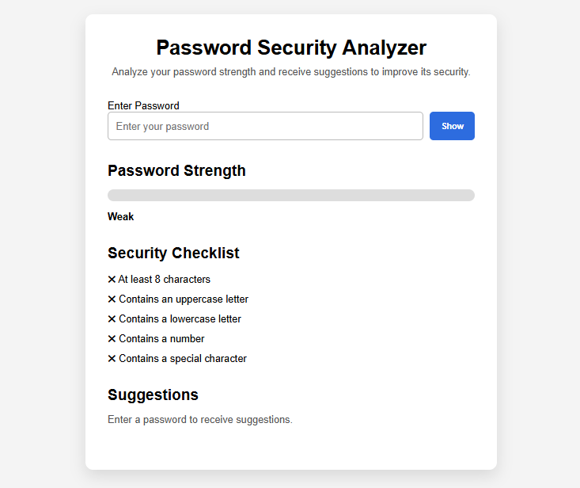
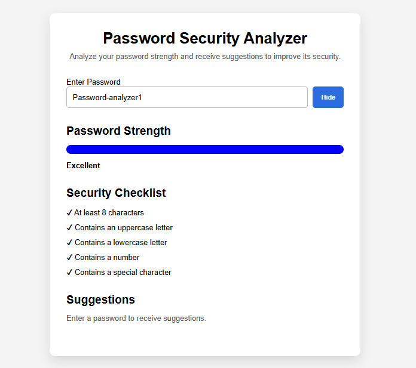
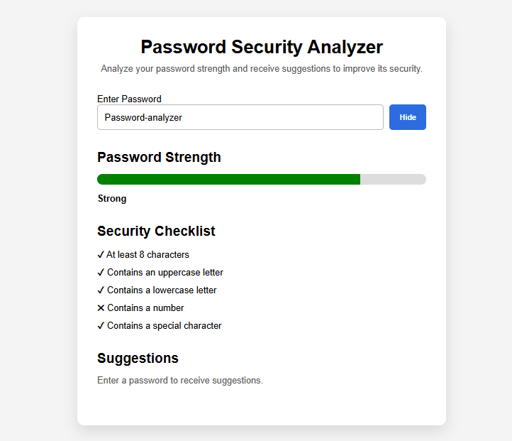

# Password Security Analyzer 🔐

A web-based password security analyzer that evaluates password strength in real time and provides instant feedback to users.

## Why I built this project

I built this project to learn more about cybersecurity concepts and improve my web development skills by creating a practical tool that helps users understand password security. Through this project, I wanted to learn how passwords can be evaluated, how security requirements affect password strength, and how interactive applications can provide real-time feedback to users.

## Features

- Real-time password analysis
- Show/hide password visibility
- Password requirement checklist:
  - Minimum length check
  - Uppercase letter detection
  - Lowercase letter detection
  - Number detection
  - Special character detection
- Password strength score calculation
- Visual strength meter
- Strength rating:
  - Weak
  - Medium
  - Strong
  - Excellent
- Password entropy calculation
- Estimated password cracking time
- Password statistics:
  - Total password length
  - Unique characters
  - Repeated characters
  - Character diversity
  - Uppercase, lowercase, number, and special character counts
- Common password detection
- Password improvement suggestions
- Secure password generator:
  - Customizable password length (8–32 characters)
  - Uppercase, lowercase, numbers, and special characters
- Password breach checker:
  - Have I Been Pwned API integration
  - Privacy-preserving k-anonymity lookup
  - Local SHA-1 hashing
  - Exposure count and visual result feedback

## Privacy and Security

- Passwords are analyzed locally in the browser.
- The original password is never sent to the Have I Been Pwned API.
- The breach checker uses SHA-1 hashing and the k-anonymity model.
- Only the first five characters of the password hash are sent to the API.
- The remaining hash is compared locally against the API response.
- The application does not intentionally store or save passwords.

## Screenshots

### Main password analyzer interface

### Excellent password example

### Strong password example

## Technologies Used

- HTML
- CSS
- JavaScript
- Web Crypto API
- Have I Been Pwned Pwned Passwords API

## How It Works

The application analyzes passwords in real time and evaluates multiple security characteristics.

- Password requirements are checked as the user types.
- A strength score (0–100) is calculated based on password characteristics.
- Password entropy and estimated cracking time provide additional security insights.
- Common passwords are identified to help users avoid predictable choices.
- The password generator creates passwords using customizable length and character options.
- The breach checker uses the Have I Been Pwned API and k-anonymity to check for known password exposures without sending the original password.

The results are displayed through a visual strength meter, security statistics, and feedback messages.

## Future Improvements

Planned improvements:

- Improve the user interface and mobile responsiveness.
- Add more comprehensive testing and error handling.

## Project Status

🚧 Currently under development

More security features and improvements will be added over time.

## Author

Created by Alex F. as a personal project exploring cybersecurity concepts, password security, and web development using HTML, CSS, and JavaScript.